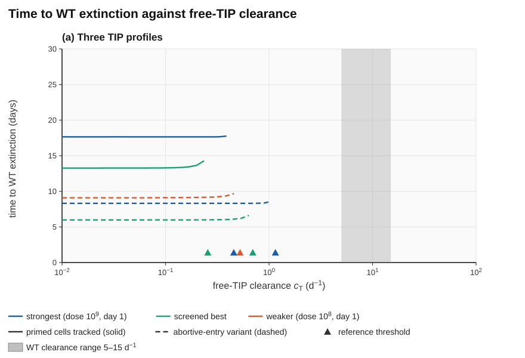
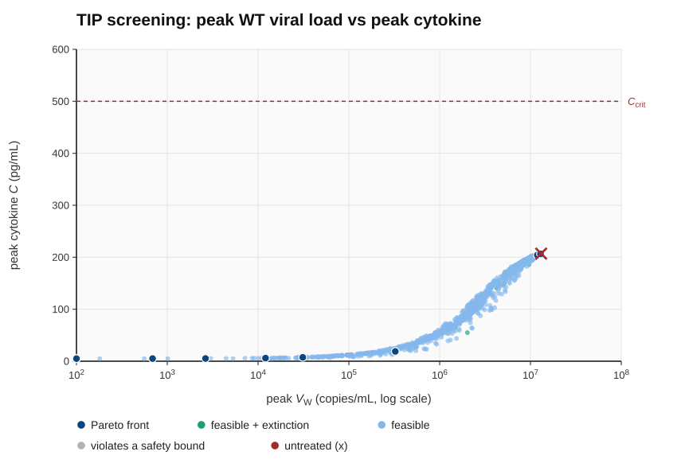
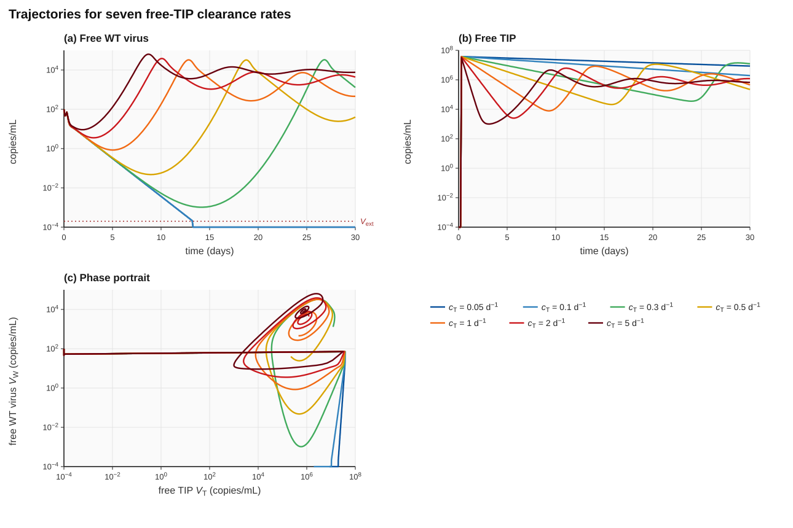
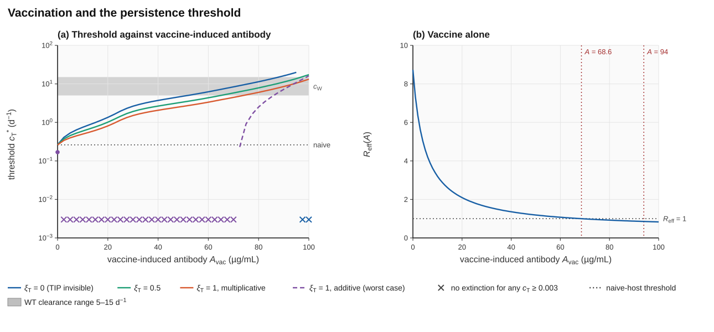
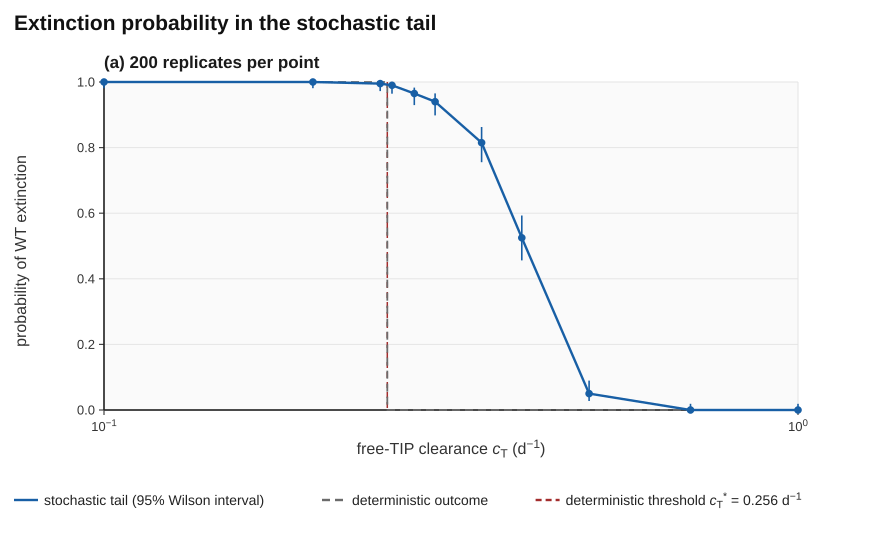

# RPT-EBOV  Persistence Limited Interference of Therapeutic Interfering Particles in Ebola Virus

**An offline, open source, reproducible decision tool that ranks candidate Ebola therapeutic interfering particles (TIPs) before they consume scarce BSL-4 time, and a pre-registered test that will say clearly whether the underlying theory survives contact with data.**

Reinford Nyachio, Maasai Mara University, Kenya · November 2026

    

<p align="center"></p>

> **Research code, not medical advice.** All outputs are simulated trajectories under stated assumptions with illustrative parameters. They are not patient-level predictions, dosing instructions or manufacturing recommendations, and they need experimental confirmation. The project is a decision aid for experimental groups; it makes no therapeutic or vaccine claim and no claim of patient benefit.
>
> **Epistemic status.** Verified: numerical correctness of the solver. Not verified: biological realism of TIP behaviour. No parameter is calibrated yet, and to the author's knowledge no in vivo data on engineered Ebola TIPs existed in November 2026, so every TIP-specific statement is a model prediction for experiments to test.

| | |
|---|---|
| **ORCIDID** | 0009-0001-2401-2431 |
| **Manuscript** | [`Rein_Persistence_Theory_EBOV_Nyachio_Final.docx`](Rein_Persistence_Theory_EBOV_Nyachio_Final.docx) (Parts I and II, 15 sections, Appendices A–E) |
| **Code and data** | This repository: engine, scripts, parameter files, every plotted number, verification log |
| **Pre-registration** | Lock list and falsifiers in the manuscript (Table 3a); OSF registration planned before any calibrated run |

---

## Summary

A TIP is a defective particle that keeps the packaging signals of the virus but lacks its essential genes. It replicates only inside a cell also infected with wild-type (WT) virus, where it diverts the replication machinery to its own genome. The theory asks when such a competitor makes the virus *fail to persist*.

The key quantity is the **persistence threshold c<sub>T</sub>\***: the free-TIP clearance rate below which WT virus is driven to extinction. For the reference profiles c<sub>T</sub>\* lies between about **0.26 and 0.46 d⁻¹** (free-TIP half-life of roughly 1.5–2.7 days or more), against a WT clearance rate of 5–15 d⁻¹. In plain terms: on these illustrative parameters a TIP only clears the virus if the free particle itself survives for days. This is reported as a **design requirement for experiments to check**, not as an established property of TIPs.

The work has two parts.

- **Part I**  theory, a ten-state model (target cells, WT-infected, co-infected and TIP-primed cells, free WT and TIP, cytokine, autonomic pulse), a zero-dependency C++20 engine (RK4 integrator), a screening module that ranks 2000 TIP profiles, and an Android app that runs offline.
- **Part II**  mechanism and robustness (threshold mapped over dose and clearance, local sensitivity, cytokine safety coupling), an adaptive immunity and vaccination extension, a stochastic analysis of establishment and extinction, and a specification for pan-filovirus, tropism and compartment extensions.

## Headline results

All numbers are produced by this repository (`verification_log.txt`, `figure_data/`); none is typed in by hand.

| Result | Value |
|---|---|
| Basic reproduction number of the untreated host, R₀ | 8.73 |
| Analytic entry-blocking threshold, 1 − 1/R₀ | 0.88545 |
| Analytic clearance-gain threshold, R₀ − 1 | 7.7302 |
| Persistence threshold, screened best profile (primed / abortive entry) | 0.256 / 0.696 d⁻¹ |
| Persistence threshold, strongest profile at dose 10⁹ (primed / abortive) | 0.456 / 1.151 d⁻¹ |
| Overstatement if primed cells are ignored | about 2.5× |
| Screening: profiles reaching extinction among 2000 (all feasible) / Pareto front size | 33 / 11 |
| Peak WT load, untreated vs screened best | 1.3×10⁷ → 100 (the inoculum floor, i.e. extinct) |
| Peak cytokine, untreated vs screened best (safety bound 500 pg/mL) | 207 → 5.0 |
| Robustness: largest c<sub>T</sub>\* after ±25 % change in any of 15 parameters | 0.393 d⁻¹ (never above 0.4) |
| Vaccine antibody needed for R<sub>eff</sub> = 1 / 60-day extinction without TIP | 68.6 / 94.0 µg/mL |
| Vaccine plus TIP | Threshold rises from 0.26 to above 1 d⁻¹ at moderate titres if the TIP is antigenically distinct; the combination fails if antibody clears the TIP additively |
| Probability that a single WT virion establishes infection (naive host) | 0.030 (not 1 − 1/R₀ = 0.89); Monte Carlo agrees within 0.8 standard errors |
| Stochastic tail: extinction probability at c<sub>T</sub> = 0.25 / 0.40 / 0.50 d⁻¹ | 0.995 / 0.525 / 0.05 (the deterministic threshold is conservative) |
| RK4 convergence order (self-test) | 4.037 |

**What the work does not show:** no parameter is calibrated; no in vivo TIP data exist; the TIP versus antibody interaction is an assumption in two alternative forms; the multi-species and multi-compartment structure is a specification, not a result. The cytokine safety constraint did not bind in any tested profile, so safety rankings are currently uninformative.

<table>
<tr>
<td></td>
<td></td>
</tr>
<tr>
<td align="center"><sub>Screening 2000 TIP profiles: peak WT load vs peak cytokine</sub></td>
<td align="center"><sub>Trajectories at seven c<sub>T</sub> values straddling the threshold</sub></td>
</tr>
<tr>
<td></td>
<td></td>
</tr>
<tr>
<td align="center"><sub>Vaccination lowers the bar the TIP has to clear</sub></td>
<td align="center"><sub>Stochastic tail: extinction probability against c<sub>T</sub></sub></td>
</tr>
</table>

## What would prove it wrong

The theory is stated so that it can fail. Six falsifiers carry numeric rules (manuscript Table 3a; full text in the manuscript).

| ID | The theory is rejected or revised if | Status |
|---|---|---|
| F1 | Free-TIP half-life is below 1.4 d yet WT clearance is sustained | Open; needs experiment |
| F2 | TIP-only cells are protected from later WT entry by a fraction of 0.5 or more (proposed threshold) | Open; needs experiment |
| F3 | Calibrated parameters put c<sub>T</sub>\* inside the WT clearance range of 5–15 d⁻¹ | Pending calibration (Aim 1) |
| F4 | Stochastic extinction probability is below 0.5 at 0.9 × c<sub>T</sub>\* (proposed threshold) | Not triggered (P = 0.995–1.00 up to 0.25 d⁻¹) |
| F5 | Post-vaccination sera clear a TIP at 3 d⁻¹ or more (proposed threshold) | Open; needs experiment |
| F6 | Antibody in vaccinated hosts exceeds A<sub>crit</sub> = 68.6 µg/mL | Open; needs data |

**Stop rule.** Calibration to published EBOV kinetics (Aim 1) has a stated tolerance: simulated peak viral load within 0.5 log₁₀ and time of peak within 2 days of each reference curve, antibody peaks within a factor of 2 (proposed; to be confirmed before fitting). If the calibrated model cannot meet it, the quantitative claims are withdrawn and reported as a negative result. The measurements that experiments would need (manuscript Table 20) are the experimental shopping list of this work.

## Verification record

These checks show the code solves the stated equations correctly. They say nothing about whether the equations describe a real TIP.

| Check | Result | Reproduced by |
|---|---|---|
| RK4 convergence order | 4.037, PASS (criterion 3.8–4.2) | `./engine --selftest input.txt` |
| Bitwise determinism | Screening CSV SHA-256 `8408cc08…` identical on 1 and 4 threads | `bash check_determinism.sh` |
| Threshold behaviour | 1 − 1/R₀ and R₀ − 1 matched to seven or more digits (differences below 10⁻¹⁴) | `python3 verify_threshold.py` |
| Equilibrium | Six strongly perturbed starts return to the infection-free state | `make_figures.py` (Fig. 5b) |
| Adaptive extension vs core | With the adaptive block frozen, seven parameter sets agree to four significant figures | manuscript Section 7.5; `rpt_adapt.cpp` |
| Sanitisers | ASan and UBSan clean on self-test and a trajectory run | `bash check_sanitisers.sh` |
| Figures | 17 of 17 regenerate from code; every plotted point is compared with engine output | `bash run_all.sh`, `verify_figures.py` |
| Continuous integration | All of the above on every push | `.github/workflows/build.yml` |
| Claims and language | No over-claiming phrases; eponym limit | `python3 claims_check.py` |

Not yet measured: parallel scaling and a large fuzz campaign.

## Quick start

Requirements: a C++20 compiler (g++ 11+); for figures, Python 3.10+ with the packages in `requirements.txt`, `rsvg-convert` (package `librsvg2-bin`) and the DejaVu fonts.

```bash
git clone https://github.com/rein-baremetal/ebola-within-host-model.git && cd RPT-EBOV
bash run_all.sh       # builds, tests, regenerates all figures, checks them, rebuilds the .docx (~2-8 min)
```

Or step by step (the engine alone needs nothing but the compiler):

```bash
g++ -std=c++20 -O2 -pthread -Wall -Wextra code_annotated.cpp -o engine
g++ -std=c++20 -O2 rpt_adapt.cpp -o rpt_adapt

./engine --selftest input.txt                        # RK4 order check -> 4.037 PASS
bash check_determinism.sh && bash check_sanitisers.sh # SHA-256 across thread counts; ASan + UBSan
python3 verify_threshold.py input.txt                # analytic thresholds to seven digits
./engine input.txt out.txt errors.txt                # one trajectory + SVG dashboard
./engine --screen screen.txt input.txt errors.txt    # rank 2000 TIP profiles -> Pareto front + best profile
```

**Expected output.** The default `input.txt` gives `R0=8.73  peakV=1.87e+06 (t=2.84)  peakC=96.9  peakH=94.2  extinct=no`. The reference screen (seed 12345) reports `valid 2000, feasible 2000, feasible+extinct 33, Pareto 11` in a few seconds, and `screen_report.txt`, `screen_samples.csv` and the screen SVGs regenerate byte-identical to those in this repository.

Edit `input.txt` (parameters, TIP dose and timing, run control) and `screen.txt` (search space, seed) to run your own scenarios. Set `tip_dose = 0` for an untreated baseline. Plain-text in, plain-text out, so the data outlive the software.

## Reproducing the manuscript figures

Every one of the 17 manuscript figures is generated by code here, and the captions state their recipes. `figure_data/*.csv` holds the exact numbers each figure plots.

| Figure(s) | Script | Source of numbers |
|---|---|---|
| 1, 3 | `code_annotated.cpp` (`--screen`) | engine screen, 2000 profiles |
| 5, 7, 13, 15 | `make_figures.py` | RK4 convergence, model schematic, vaccination trajectories, antibody sweep |
| 2, 4, 6, 8–12, 14, 16, 17 | `make_figures_analysis.py` | threshold bisection, extinction maps, sensitivity, Monte Carlo, Gillespie tail |

```bash
python3 make_figures.py                     # Figures 5, 7, 13, 15
python3 make_figures_analysis.py            # the rest (about 5 min)
python3 make_figures_analysis.py . fig17    # one figure
python3 verify_figures.py sample_trajectory.svg sample_trajectory.txt untreated_output.txt
python3 verify_figures.py --pareto screen_pareto.svg screen_samples.csv
python3 build_docx_figures.py               # write pictures and captions into the .docx
```

`verify_figures.py` converts every plotted point back to data units and compares it with engine output (trajectory points agree to 2×10⁻⁵ of the axis range; all 2000 Pareto circles match `screen_samples.csv`). Built-in layout checks test text overlap, text leaving the canvas, annotations on data lines and overflow in diagram boxes. Note that `untreated_output.txt` is created by `run_all.sh`.

<details>
<summary><b>Figure recipes</b></summary>

| Fig | Recipe |
|---|---|
| 2 | Strongest = `REFINED` at dose 10⁹, day 1; screened best = `BEST` from `screen_report.txt`; weaker = β<sub>T</sub> 5×10⁻⁷, α 0.2, p<sub>T</sub> 1500, dose 10⁸, day 1 |
| 4 | Untreated, weaker and screened-best arms (c<sub>T</sub> = 0.18 d⁻¹) |
| 5 | RK4 error for h = 0.05 … 0.003125 d against h = 0.0004 d; local orders 4.33, 4.17, 4.09, 4.05; six perturbed starts over 400 d |
| 6 | Largest eigenvalue of the (E<sub>W</sub>, I<sub>W</sub>, V<sub>W</sub>) block against full nonlinear runs (agreement within 5×10⁻⁵ d⁻¹) |
| 8 | 36 c<sub>T</sub> values (0.01–20) × 48 doses (10⁵–10⁹), primed and abortive variants |
| 9 | c<sub>T</sub> = 0.05, 0.1, 0.3, 0.5, 1, 2, 5 |
| 10 | α 0.02–0.6; p<sub>T</sub>/p<sub>W</sub> 1–10; β<sub>T</sub>/β<sub>W</sub> 0.5–8; dose 10⁵–10⁹ |
| 11 | 15 parameters, ±25 %, baseline c<sub>T</sub>\* = 0.256 d⁻¹ |
| 12 | 13 values of ρ<sub>T</sub> from 0 to 3×10⁻³ (c<sub>T</sub>\* 0.256 → 0.373) |
| 13, 15 | naive vs vaccinated hosts, A<sub>vac</sub> = 50 µg/mL; antibody sweep 0–100 µg/mL |
| 14 | four antibody-recognition assumptions |
| 16 | eight Monte Carlo parameter sets (6000–20000 lineages each) |
| 17 | 11 c<sub>T</sub> values, 200 replicates, 300 starting virions, Wilson 95 % intervals |

</details>

## Repository layout

| Path | Purpose |
|---|---|
| `Rein_Persistence_Theory_EBOV_Nyachio_Final.docx` | The manuscript: theory, equations, results, adaptive immunity, stochastic boundaries, falsification criteria, full annotated source in appendices |
| `code_annotated.cpp` | Core engine (C++20, no dependencies): RK4 integrator, screening, SVG output, layout checker, C API |
| `rpt_adapt.cpp` | Adaptive-immunity extension and command-line driver for the analysis scripts |
| `analysis_scripts.py` | `run()`, `cT_star()` bisection, `mc()`, `q_theory()`, `tail_sim()` |
| `make_figures.py`, `make_figures_analysis.py` | Figure generators |
| `verify_figures.py`, `build_docx_figures.py` | Figure check and manuscript builder |
| `verify_threshold.py`, `check_determinism.sh`, `check_sanitisers.sh`, `claims_check.py` | Verification and language checks (run by `run_all.sh` and CI) |
| `test_api.cpp` | C-API test (also the JNI entry point for Android) |
| `input.txt`, `screen.txt` | Parameter and search-space files |
| `figure_data/` | CSV of every plotted number |
| `fig*.svg`, `screen_*`, `sample_*` | Manuscript figures; reference 2000-profile screen; short 40-profile sample run |
| `equations_svg.zip` | The 36 core equations as vector SVG |
| `verification_log.txt` | Log of the checks and the numbers quoted in captions |
| `RPT-EBOV Advanced Theoretical Framework.pdf`, `ADVANCED_EXTENSIONS.md` | Advanced extensions (multi-stage entry, host-targeted drugs, condensates, latency): specification only |
| `android/` | Android app (Kotlin UI, JNI, engine built with the NDK) |
| `.github/workflows/build.yml` | Continuous integration |
| `requirements.txt`, `CITATION.cff` | Python dependencies; citation metadata |

## Model in brief

State variables: target cells T, WT-infected cells (E<sub>W</sub>, I<sub>W</sub>), co-infected cells (E<sub>Co</sub>, I<sub>Co</sub>), TIP-primed cells P, free WT virus V<sub>W</sub>, free TIP V<sub>T</sub>, cytokine C and the vagal pulse H; an adaptive block (B, A, Z) adds antibody, enhanced clearance and CTL killing. WT extinction uses an extinction floor V<sub>ext</sub> = 2×10⁻⁴ copies/mL; safety uses a cytokine bound C<sub>crit</sub> = 500 pg/mL. Equations 1–14 are implemented literally in `code_annotated.cpp`; the equations as typeset SVG are in `equations_svg.zip`. Units are cells/mL, virions/mL and days throughout.

### What is implemented and what is only specified

| Component | Status |
|---|---|
| Ten-state core, RK4, stability guard, screening | Implemented (`code_annotated.cpp`) |
| Adaptive immunity and vaccination (B, A, Z) | Implemented (`rpt_adapt.cpp`), cross-validated against the core |
| Establishment probability (branching process) | Derived and validated (Python); C++ port planned |
| Stochastic tail extinction check (Gillespie) | Implemented (Python); C++ port planned |
| Cross-reactive antibody matrix, several species | Specified only |
| Tropism (macrophage, hepatocyte) and blood/organ compartments | Specified only |
| Calibration to published kinetics and titres | **Not done** (Aim 1) |

## Android app

The `android/` folder wraps the unchanged C++ engine in a small Kotlin app: edit parameters, tap **Run** for the summary, **Plot** for the SVG dashboard (pinch to zoom), or **Screen 200** for a short TIP-profile screen. Everything runs offline on the phone.

Download the APK from the `RPT-EBOV-apk` artifact of any successful Actions run, copy it to your phone and open it (allow "install unknown apps" for your file manager). It is signed with the automatic debug key, which is fine for sideloading but not for the Play Store. To build locally: `cd android && gradle assembleDebug` (needs JDK 17, the Android SDK and NDK).

## Continuous integration

Each push runs `.github/workflows/build.yml` with three jobs:

1. `engine`: builds the engine and requires the RK4 self-test, determinism check, sanitiser build, threshold check and claims check to pass.
2. `figures`: regenerates all figures, runs the verification, rebuilds the manuscript and uploads `regenerated-figures-and-docx`.
3. `android`: builds the APK and uploads `RPT-EBOV-apk`.

## Roadmap

| Aim | Months | Work | Stop rule |
|---|---|---|---|
| 1. Calibrate | 1–8 | Calibrate core and adaptive constants to published EBOV kinetics and vaccine titres | Peaks and timings within the pre-registered tolerance, otherwise quantitative claims are withdrawn |
| 2. Extend | 6–16 | C++ port of stochastic and establishment modules; tropism and compartment extensions; recompute c<sub>T</sub>\* with sanctuary compartments | C++ output identical to the Python reference; conservation checks pass |
| 3. Deliver | 14–24 | Ranked, uncertainty-bounded shortlist; time-stamped falsification protocol; open release | Shortlist with uncertainty bounds |

## Limitations

The model is a compact mechanistic abstraction of a single well-stirred compartment. It does not capture adaptive immune memory in detail, tissue heterogeneity, interferon-mediated protection of primed cells or co-infection with other pathogens, and it does not address transmission or the evolution of resistance. The advanced extensions are a theoretical specification and are not yet in the state vector. Parameter values are illustrative placeholders until calibrated. The cytokine safety constraint did not bind in any tested profile; it would bind if free-TIP innate stimulation exceeds about 10⁻⁴ (pg/mL/d per copy/mL) or if calibrated cytokine parameters violate the monostability condition (manuscript Section 8.1). The stochastic tail model takes its environment from the deterministic solution and starts at a modelling choice of 300 copies per host.

## Biosafety and dual use

The study is purely in silico. The engine works with abstract kinetic parameters and produces no genetic sequences, construct designs or protocols, and neither this repository nor the manuscript contains any. Anyone extending the engine toward sequence-level design should seek independent biosafety and dual-use review first (manuscript Section 8.3).

## Contributing

Issues and pull requests are welcome: parameter corrections with sources, new analyses, and ports of the Python drivers to C++.

## Citation

> Nyachio, R. (2026). *Persistence-limited interference of therapeutic interfering particles in Ebola virus (RPT-EBOV).* Maasai Mara University. Software and manuscript, November 2026. bioRxiv preprint: *DOI to be added*.

GitHub's "Cite this repository" button reads `CITATION.cff`.

## License

MIT — see [LICENSE](LICENSE). Copyright © 2026 Reinford Nyachio.
